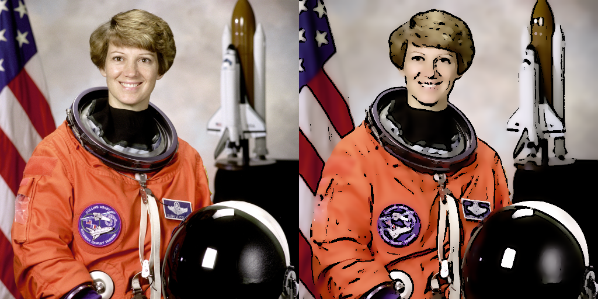

# Cartoonify Image using GANs

Turn photos, videos and GIFs into cartoon-style versions. Built with **Python, OpenCV and TensorFlow**.
This work was published as a paper: *"Cartoonify Image Using GAN"*, International Journal of Innovative Science
and Research Technology (IJISRT), Vol. 8, Issue 3, March 2023 (see `docs/IJISRT23MAR1438_paper.pdf`).

## What is in this repo
| Part | What it does | Needs training? |
|---|---|---|
| `src/classic.py` | Classic OpenCV cartoon filter plus denoise, upscale and brightness tools (the "Image-hub") | No |
| `src/video.py` | Cartoonizes a video frame by frame, and converts video to GIF | No |
| `src/gan_model.py`, `src/train.py`, `src/data.py` | CartoonGAN-style GAN (generator + PatchGAN discriminator) in TensorFlow | Yes |
| `src/infer.py` | Runs a trained generator on an image | Needs weights |
| `scripts/cartoonify.py` | Command line tool for image / video / gif | No |
| `scripts/benchmark_latency.py` | Measures inference time per image | No |
| `tests/` | Unit tests for the classic pipeline | No |

## Example (classic filter)
Left: input. Right: output. (Test image: NASA astronaut photo bundled with scikit-image, public domain.)



## Quick start
```bash
pip install -r requirements.txt
python scripts/cartoonify.py image samples/input.png out.png --denoise --upscale 1.5
python scripts/cartoonify.py video my_clip.mp4 cartoon_clip.mp4
python scripts/cartoonify.py gif   my_clip.mp4 clip.gif
```

## Training the GAN
1. Put real photos in `data/photos/` and cartoon/anime frames in `data/cartoons/` (the two sets do not need to match).
2. Run:
```bash
python -m src.train --photos data/photos --cartoons data/cartoons --epochs 20 --steps 500
python -m src.infer my_photo.jpg cartoon.jpg
```
How it learns: the discriminator learns to tell real cartoon frames from generated ones, while the generator tries
to fool it. A content loss (VGG19 features) keeps the generated image looking like the original photo.
Augmentation used: random crop, horizontal flip and small brightness changes.

## Measuring speed
```bash
python scripts/benchmark_latency.py --image samples/input.png
python scripts/benchmark_latency.py --image samples/input.png --gan checkpoints/generator.weights.h5
```
Run it before and after any change (smaller generator, mixed precision, TFLite) and compare the median times.

## Status (honest summary)
- The classic pipeline, video/GIF tools, CLI and unit tests were run and pass.
- The GAN training code is written to follow the design above, but **trained weights and training results are not included in this repo**.
  Add your own numbers here after you train and evaluate:

| Metric | Value | How measured |
|---|---|---|
| Training images / frames | _fill in_ | |
| Style quality (e.g. user rating, FID) | _fill in_ | |
| Inference latency before / after | _fill in_ | `scripts/benchmark_latency.py` |

## Limitations
The classic filter is a fast, simple effect and does not learn a style. The GAN gives more natural cartoon looks but
needs data, GPU time, and careful tuning. Video output has no audio unless you add it back (for example with ffmpeg).

## Reference
Y. Chen, Y.-K. Lai, Y.-J. Liu, *CartoonGAN: Generative Adversarial Networks for Photo Cartoonization*, CVPR 2018;
I. Goodfellow et al., *Generative Adversarial Nets*, NIPS 2014.
